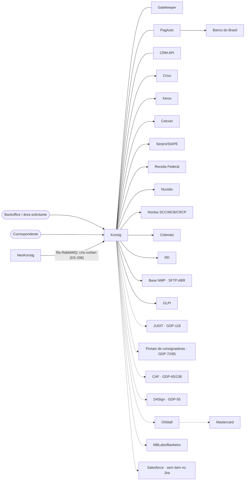

# SISTEMA · [Konsig | outro do Inventário] · kit-dev v2 · 17/11/2026 · proposta

> Tipo Diátaxis: **referência** (consulta de fato exato, não tutorial). arc42 enxuto: seções 3 (contexto), 9 (decisões) e 11 (riscos), mais o C4 nível 1. Fica em `docs/SISTEMA.md` do repositório do sistema; enquanto o repositório do Konsig estiver [A CONFIRMAR] (DS-175/DS-495), use a pasta provisória definida no README do kit, seção 4. O `AGENTS.md` aponta para cá. Um arquivo por sistema, **Konsig primeiro**. Recorte das seções do arc42 e escolha do C4: [ALÉM DA FONTE — decisão do usuário].

## Quando usar / quando não usar
- **Leia** na primeira demanda num sistema e quando um dev chega ao sistema (em 2027 o time inteiro vai para o Konsig). **Atualize** no mesmo PR que muda integração, repositório, ambiente, estado da proposta ou risco.
- **Não use** para: detalhe de uma integração (ficha `docs/integracoes/<parceiro>.md`, CONTRATO-DE-INTEGRACAO.md); motivo de uma decisão (ADR.md); passo a passo (RUNBOOK.md); requisito de demanda (PRD.md).
- **NeoKonsig não ganha SISTEMA.md próprio:** termina na Entrega 1, e o que fica registrado dele vai no PASSAGEM.md. [ALÉM DA FONTE — decisão do usuário]
- **Regras:** só nomes, nunca valor de segredo, host, conta ou dado pessoal. Afirmação de stack sem fonte leva "a confirmar no Inventário". Campo sem resposta fica `[A CONFIRMAR]` com o card que responde; nunca apague a linha.
- **Por que existe:** não há AS-IS da esteira nem guia de entrada no Konsig; o Inventário de Sistemas e o "Konsig Arquitetura" não foram recebidos [A CONFIRMAR] (`insumos/sistemas-e-tecnologias.md` §1.3).

## Modelo (preenchido como ponto de partida do Konsig)

### 1. Contexto e escopo (arc42 §3 · C4 nível 1)
*Instrução:* um nó por usuário, sistema Neo e parceiro. Seta cheia = integração em produção; tracejada = prevista ou em Backlog. Cada parceiro tem `click` para a sua ficha. Nível 2 (contêineres) só quando o Inventário e o "Konsig Arquitetura" forem recebidos [A CONFIRMAR]. Base: os 26 parceiros de `insumos/sistemas-e-tecnologias.md` §4 (Jira de 16/11/2026).

- **Status das setas** (conferido contra `insumos/sistemas-e-tecnologias.md` §4): JUDIT tracejada porque o GDP-118 está Em Downstream e os épicos DS-454 e DS-466 têm 5 cards cada, nenhum concluído (`gdp_16-11.csv`, 16/11/2026 9h51; `epicos_downstream_16-11.csv`, 16/11/2026 10h26). Portais de consignatárias tracejada porque o GDP-72 está em Backlog Upstream e o GDP-85 em Priorização Upstream (`gdp_16-11.csv`, 16/11/2026 9h51). As setas cheias são de parceiros com item concluído no Konsig segundo o §4; GLPI tem bot associado ao Konsig, e a integração com o Jira está em Backlog.
- **Fora do diagrama, com motivo:** Atlanta (integração sistêmica não definida), Printer/embossadora (sistema não definido), OMIE (sistema não identificado, GDP-119), Slack, AWS e Compupack (corporativos ou infraestrutura). Repetir a linha `click` para cada parceiro.

### 2. Repositórios, ambientes e variáveis
*Instrução:* sistema → repositório → dono por papel → ambientes → **nomes** de variáveis. Nunca valores.

| Serviço | Repositório | Dono (papel) | Ambientes | Variáveis (só nomes) | Fonte / pendência |
|---|---|---|---|---|---|
| API Konsig (PHP) | `api` | [A CONFIRMAR] | local · stag · produção | [A CONFIRMAR] | konsig-api-php (DS-322); subtarefas DS-555/DS-557/DS-558 do DS-550 (`downstream_16-11.csv`, 16/11/2026 10h26) |
| Front Konsig | `konsig/www` | [A CONFIRMAR] | [A CONFIRMAR] | [A CONFIRMAR] | DS-274, DS-472 (subtarefas do DS-175) |
| Módulos Node | `node`, `node-v2` | [A CONFIRMAR] | [A CONFIRMAR] | [A CONFIRMAR] | DS-78, DS-221 |
| CRM API | `crm-api` | [A CONFIRMAR] | [A CONFIRMAR] | reorganização sem descrição: DS-519 | DS-487 |
- Migração dos repositórios: DS-175 (Em desenvolvimento, sem descrição, 6 sprints segundo a Review S18, 06/11/2026 16h46) e DS-495 (Backlog). Rede do stag: DS-168 (Bug concluído em 18/08/2026). Persistência do Elastic: DS-123 (concluído em 31/08/2026; a descrição diz que a correção não foi mergeada na develop: [A CONFIRMAR] se está em produção) (`downstream_16-11.csv`, 16/11/2026 10h26).

### 3. Modelo de domínio e glossário
*Instrução:* a proposta como máquina de estados (situação + atividade). Uma linha por transição; exceções viram linha própria. Por que: 3 dos 31 Bugs do Downstream ligados à movimentação da proposta na esteira ou ao lock da ficha: DS-28, DS-364 e DS-388 (`downstream_16-11.csv`, 16/11/2026 10h26; lista e critério em `METODOLOGIA.md` do kit, seção 4; classificação própria [ALÉM DA FONTE — decisão do usuário]). Base: DS-318, DS-378 (grafo) e o `.md` das etapas do DS-401, **não recebido** [A CONFIRMAR].

| Situação | Atividade | Gatilho (evento, perfil ou rotina) | Vai para | Exceção / observação |
|---|---|---|---|---|
| [A CONFIRMAR DS-401] | [A CONFIRMAR] | [A CONFIRMAR] | [A CONFIRMAR] | — |
| (qualquer) | (qualquer) | paradinha | [A CONFIRMAR] | retorno ao status anterior? [A CONFIRMAR] |
| (qualquer) | (qualquer) | reanálise | [A CONFIRMAR] | quem pode acionar (matriz perfil × etapa: DS-83, DS-84, DS-205) |

**Tipos de proposta.** 19 e 21 = "Novo", propostas novas de cartão benefício (DS-548, Bug concluído em 12/11/2026). Demais tipos: [A CONFIRMAR]. Se "Esteira de Novos" é a esteira desse tipo: [A CONFIRMAR com a área solicitante].

| Termo / código | Definição | Fonte |
|---|---|---|
| Averbação · margem consignável · RMC | copiar do Anexo I | Visão do Cartão v6 (03/11/2026); a v6 atribui o pós-faturamento ao NeoKonsig e precisa de correção para v7 |
| AND - AGUARD QUITACAO | [A CONFIRMAR] | citado na Quitação, sem definição |
| D01 / D02 (códigos da planilha de quitação, DS-501/DS-503; pendência "V04 anexado ao DS-500" na seção 7 do PRD GDP-76) | [A CONFIRMAR] | citados na Quitação, sem definição |

### 4. Decisões (arc42 §9)
*Instrução:* só o índice; o conteúdo fica em `docs/adr/ADR-<nnnn>_<chave>_<assunto>.md` (ADR.md; README do kit, seção 5). ADR substituído continua na lista com "substituído por".

| ADR | Título | Status | Data |
|---|---|---|---|
| 0001 | PagAuto + API do BB no pagamento da Quitação (`exemplos/quitacao/`) | Aceito | 09/11/2026 |
| 0002 | Ordem das fases da Quitação, integração bancária por último (`exemplos/quitacao/`) | Aceito | 09/11/2026 [A CONFIRMAR] |
| a abrir [ALÉM DA FONTE — decisão do usuário] | Autenticação por header em vez de token na URL (DS-81) · padrão de log ECS (DS-24, DS-412) · padrão de release (DS-550) | — | — |

### 5. Riscos e dívida técnica (arc42 §11)
*Instrução:* risco com evidência e card. Sem card = `[A CONFIRMAR: abrir card]`.

| Risco | Evidência | Card / mitigação |
|---|---|---|
| Sem CI/CD padronizado no Konsig; deploy da API e mudança de banco em produção manuais [A CONFIRMAR] | US-43 em Backlog (`upstream_16-11.csv`, 16/11/2026 9h51). Há CD parcial no konsig/www (DS-472, concluído em 06/11/2026) e migration inicial só para banco local no node-v2 (DS-221, concluído em 16/09/2026) (`downstream_16-11.csv`, 16/11/2026 10h26) | RUNBOOK de deploy; US-43; DS-550 |
| Regressão automatizada em 3 de 12 cards | DS-53 (`epicos_downstream_16-11.csv`, 16/11/2026 10h26) | testes de caracterização antes de alterar código [ALÉM DA FONTE — decisão do usuário] |
| Token do usuário na URL; mudança afeta bots, swagger, terceiros e gatekeeper | DS-81, Backlog, épico DS-65 (`downstream_16-11.csv`, 16/11/2026 10h26) | ADR de autenticação [ALÉM DA FONTE — decisão do usuário] |
| Observabilidade sem controle central (log, APM, heartbeat) | DS-24: 5 cards, 0 concluídos, 5 abertos (3 em Backlog, 2 em Pausado) (`epicos_downstream_16-11.csv`, 16/11/2026 10h26). Cards: DS-25 filebeat, DS-186 heartbeat e DS-188 Redis em Backlog; DS-201 e DS-26 pausados; DS-305 (migração do APM) pausado (`downstream_16-11.csv`, 16/11/2026 10h26) | catálogo de serviços com log/APM [ALÉM DA FONTE — decisão do usuário] |
| Consumidores da API do Konsig desconhecidos | DS-81 pergunta "quem consome?" (`downstream_16-11.csv`, 16/11/2026 10h26) | [A CONFIRMAR: abrir card de inventário] |
| Upgrade do PHP 7.3 → 8 gerou Bugs de efeito colateral | DS-407, DS-409, DS-412, DS-432 (`downstream_16-11.csv`, 16/11/2026 10h26) | checklist de upgrade [ALÉM DA FONTE — decisão do usuário] + DS-53 |

### 6. O que NÃO existe neste sistema (para quem vem do NeoKonsig)
| No NeoKonsig | No Konsig |
|---|---|
| CI/CD (DS-315, DS-494) | Sem CI/CD padronizado (US-43 em Backlog, `upstream_16-11.csv`, 16/11/2026 9h51). CD parcial no konsig/www (DS-472, concluído em 06/11/2026); migration só para banco local no node-v2 (DS-221). Deploy da API manual [A CONFIRMAR]: ver `docs/runbooks/` |
| Jornadas de cadastro na pipeline (DS-471, em Code Review em 16/11/2026) | Regressão automatizada: 3 de 12 cards concluídos no DS-53 (`epicos_downstream_16-11.csv`, 16/11/2026 10h26) |
| Logs no formato ECS (DS-511) | Só no `konsig-api-v1` (DS-412); sem padrão central (DS-24) |

**Stack (toda a confirmar no Inventário):** PHP 8 + Doctrine (DS-399, DS-407), Node (DS-221), websocket com Redis (DS-214), filas bull (DS-27), Elastic Stack/APM (DS-412), Docker (DS-168). Banco de dados: a confirmar no Inventário.

## Referências de mercado
- C4 model (Simon Brown), níveis de contexto e contêiner: https://c4model.com/
- arc42, 12 seções, todas opcionais; aqui só 3, 9 e 11: https://arc42.org/overview
- Diátaxis, um tipo por documento (este é referência): https://diataxis.fr/
- Docs-as-code (Write the Docs), documento no repositório e revisado no PR: https://www.writethedocs.org/guide/docs-as-code/
- Leitura feita por resumo de busca em 16 e 17/11/2026 (sites bloqueados na sessão); conferir o original antes de citar em documento oficial.
